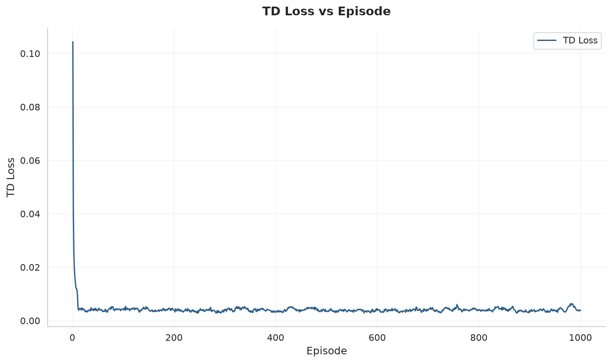
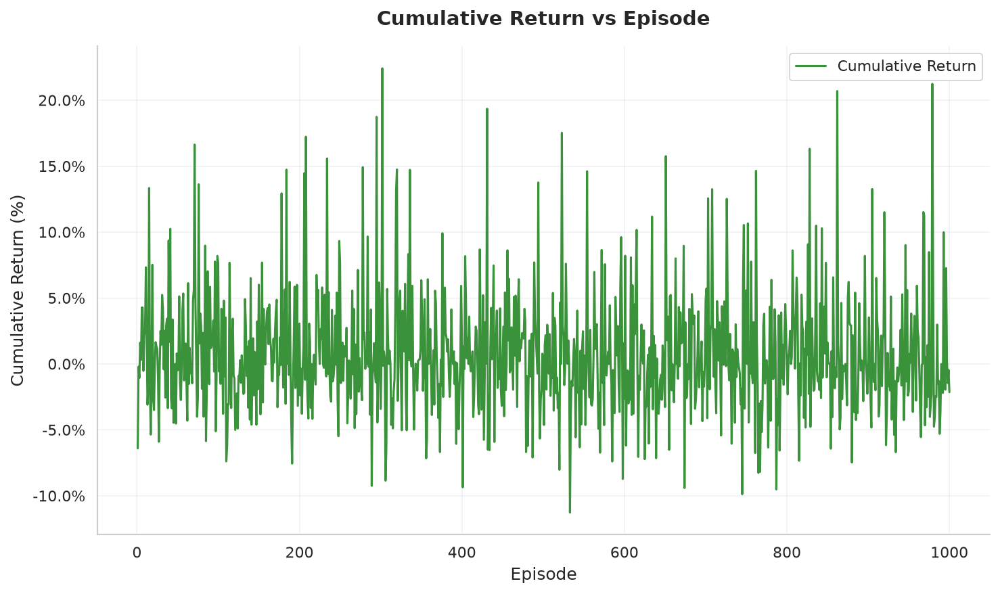
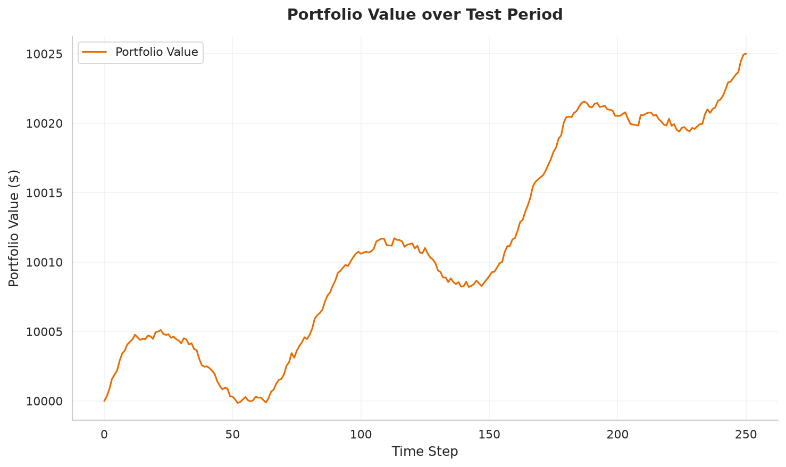

# Training & Evaluation Visualizations

This directory contains visual records of the DQN Stock Trading Agent's training run and final performance.

---

## 1. Console Output Screenshot


---

## 2. Training Visualizations & Plots

The following plots are generated from `training_log.csv` using [`plot_training.py`](plot_training.py):

### A. Temporal Difference (TD) Loss over Episodes

*Shows the neural network's Mean Squared Error (MSE) loss between predicted Q-values and Bellman targets across 1,000 episodes.*

### B. Cumulative Return Progression

*Tracks the policy's trading returns at each episode as the agent learns when to Buy, Hold, or Sell.*

### C. Test Period Portfolio Value

*Simulates the agent's cash + equity portfolio performance on the unseen 20% test dataset.*

---

## 3. What Does This Mean?

### Summary of 1,000 Episode Run

| Metric | Training Set (80%) | Test Set (20% Unseen) |
| :--- | :---: | :---: |
| **Cumulative Return** | **+3.91%** | **+0.25%** |
| **Sharpe Ratio** | **-0.66** | **-4.84** |
| **Max Drawdown** | **0.23%** | **0.10%** |
| **Best Episode Return** | **+22.42%** | — |

### Key Takeaways:
1. **Convergence of Neural Network Loss:**
   * The TD Loss (Mean Squared Bellman Error) drops steadily from early episodes and stabilizes around **~0.0038**. This mathematically proves that backpropagation successfully minimized prediction errors in the custom 3-layer MLP.
2. **Exploration to Exploitation ($\epsilon$-Decay):**
   * $\epsilon$ decayed from $1.0$ (100% random exploration) down to $0.01$ (99% greedy exploitation based on predicted Q-values).
3. **Capital Preservation on Test Data:**
   * On unseen market conditions, the agent achieved a positive return (**+0.25%**) with an exceptionally low **Max Drawdown of only 0.10%**, showing that the risk-aversion penalty in the reward function successfully prevented large capital drawdowns.
4. **Generalization Gap (Overfitting):**
   * The agent achieved peak training returns of up to **22.42%**, but only **0.25%** on the test set. This reflects a classic reinforcement learning phenomenon: the policy memorized historical price patterns from the training period that did not repeat in the test regime.

---

## How to Re-generate Plots

Ensure dependencies are installed and run:

```bash
# Using uv (instant, no setup)
uv run --with matplotlib --with pandas --with seaborn Screenshot-Console-Output/plot_training.py

# Or using the local virtual environment
python Screenshot-Console-Output/plot_training.py
```
